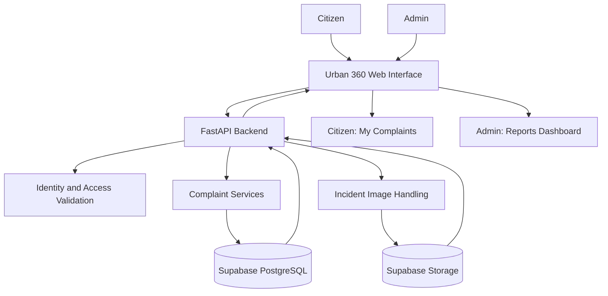
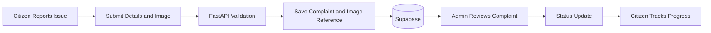

# 🏙️ Urban 360
### Connecting People with Urban Services

**Urban 360** is a civic issue management platform that connects citizens with local authorities through digital complaint registration, incident reporting, and complaint tracking.

It provides a centralized system for reporting urban issues, managing complaints, monitoring their status, and improving coordination between citizens and administrative teams.

---

## ✨ Key Features

- 📝 **Civic Reporting** — Submit complaints with descriptions, categories, locations, and incident images.
- 📍 **Complaint Tracking** — Track complaint status and view previously submitted reports.
- 🛡️ **Admin Dashboard** — Review complaints, monitor records, and manage complaint statuses.
- 🖼️ **Incident Images** — Upload and associate evidence with individual complaints.
- 🗺️ **Location Support** — Capture and display complaint locations.
- 🔄 **Persistent Records** — Store complaints and associated data in a centralized database.
- 👥 **Role-Based Interfaces** — Separate experiences for citizens and administrative users.
- ⚠️ **Error Handling** — Validate submissions and handle failed requests appropriately.

---

## 🏗️ System Architecture



### Architecture Overview

1. **Frontend:** Provides complaint submission, tracking, and administrative interfaces.
2. **FastAPI:** Handles API requests, validation, complaint operations, and image-upload workflows.
3. **Supabase PostgreSQL:** Stores complaint records and related structured data.
4. **Supabase Storage:** Stores incident images and provides the appropriate image references.
5. **Dashboards:** Retrieve persisted records to display complaints and their current statuses.

---

## 🔄 Complaint Workflow



---

## 🛠️ Technology Stack

| Component | Technology |
|---|---|
| Frontend | HTML, CSS, JavaScript |
| Backend | Python, FastAPI |
| Database | Supabase PostgreSQL |
| Image Storage | Supabase Storage |
| Maps | Leaflet.js |
| API Validation | Pydantic |
| Deployment | Vercel and existing backend hosting |

---

## 📂 Core Modules

- **Citizen Portal** — Complaint registration and personal complaint tracking.
- **Admin Portal** — Complaint review, record management, and status updates.
- **Complaint API** — Backend endpoints for creating and retrieving complaints.
- **Image Management** — Uploading and retrieving incident evidence.
- **Database Layer** — Persistent complaint records and associated metadata.

---

## 🚀 Getting Started

### Prerequisites

- Python 3.11+
- Node.js or a local static web server, if required by the existing frontend setup
- Supabase project
- Git

### Installation

```bash
git clone <YOUR_REPOSITORY_URL>
cd <YOUR_PROJECT_DIRECTORY>
```

Install the backend dependencies using the existing requirements file:

```bash
pip install -r requirements.txt
```

Configure the required environment variables using the project's environment template. Set up the Supabase database and storage configuration.

Start the FastAPI backend using the appropriate application module:

```bash
uvicorn main:app --reload
```

> Adjust the application module and frontend startup command to match the existing project structure.

---

## 🔐 Security

- Keep database credentials and API secrets in environment variables.
- Never expose Supabase service-role keys in frontend code.
- Validate incoming complaint data on the backend.
- Apply appropriate database access policies and storage permissions.
- Enforce authorization on protected administrative operations.

---

## 🎯 Project Objective

Urban 360 aims to make civic issue reporting more accessible, improve complaint visibility, and establish a structured connection between citizens and authorities.

**Report issues. Track progress. Build better communities.**

---

## 👨‍💻 Developed By

**Tejas Dubey**

Computer Engineering Student | Backend Development Enthusiast
